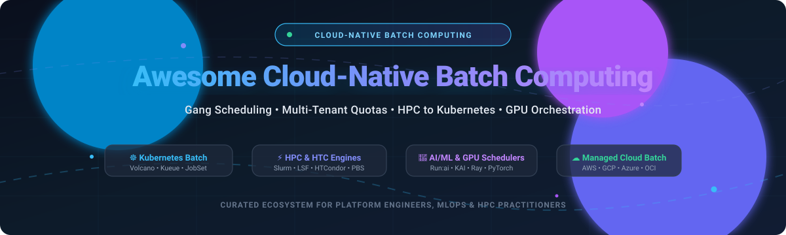

# 🚀 Awesome Cloud-Native Batch Computing

### ⚡ Curated Ecosystem of Cloud-Native Batch Computing, Gang Scheduling & HPC Platforms

  
  
  
  
  
  

**A production-tested directory of SaaS products and open-source GitHub projects for Cloud-Native Batch Computing, gang scheduling, distributed AI/ML training, queue management, multi-tenant quota sharing, and HPC-to-Kubernetes migration.**

📅 *Last updated: October 2026*

---

## 📖 Overview & SEO Summary

**Cloud-Native Batch Computing** brings the power and precision of High-Performance Computing (HPC) workload managers to modern container orchestration platforms like **Kubernetes**. From multi-role deep learning distributed training (PyTorch, TensorFlow, Ray) to scientific data modeling and genomic analysis, modern batch architectures demand:
- 🎯 **Gang Scheduling & All-or-Nothing Placement**: Co-locating interdependent tasks simultaneously to avoid deadlocks.
- ⚖️ **Hierarchical Queue & Quota Management**: Fair-share, multi-tenant cluster cohorts, and dynamic preemption.
- 🌉 **HPC-to-Kubernetes Migration**: Running Slurm, LSF, or HTCondor seamlessly alongside containerized microservices.
- ⚡ **Dynamic GPU Orchestration**: GPU fractioning, time-slicing, CUDA memory virtualization, and Multi-Instance GPU (MIG) allocation.

Whether you are building platform engineering foundations on **AWS Batch**, **Google Cloud Batch**, **Azure Batch**, or self-hosting open-source engines like **Volcano**, **Kueue**, **Nomad**, **KEDA**, or **KAI Scheduler**, this repository serves as your comprehensive reference guide.

---

## 📑 Table of Contents

- [📊 Sector Overview & Market Dynamics](#-sector-overview--market-dynamics)
- [☁️ SaaS/Hosted Platforms](#️-saashosted-platforms)
- [🛠️ Open-Source GitHub Projects](#️-open-source-github-projects)
- [⭐ Star History](#-star-history)
- [🤝 How to Contribute](#-how-to-contribute)
- [💖 Support](#-support)
- [⚖️ Disclaimer](#️-disclaimer)

## 📊 Sector Overview & Market Dynamics

The global Cloud High-Performance Computing (HPC) and Cloud-Native Batch Computing market is valued at approximately **$35B–$40B**, projected to surpass **$50B** by the late 2020s driven by distributed AI/ML training and large-scale simulation workloads. Market concentration exhibits a distinct **two-tier dynamic**: the underlying compute and silicon layers are **heavily concentrated** among hyperscaler oligopolies (AWS, Azure, GCP, NVIDIA), whereas the orchestration, workflow tooling, and scheduling layer remains **moderately to highly fragmented** across open-source engines (Kubernetes, Volcano, Kueue, Ray) and specialized platform software vendors.

## ☁️ SaaS/Hosted Platforms

| Platform | Company & Valuation / Scale | Description | Pricing (Starting Tier) | Free Tier / Trial Limits |
| :--- | :--- | :--- | :--- | :--- |
| **[Run:ai](https://www.run.ai/)** | NVIDIA (~$5.35T Market Cap) | GPU orchestration with dynamic fractions, quotas, priorities, and fair-share scheduling for AI/ML workloads. | Starting tier at ~$1.00 / GPU-hour (via cloud marketplace subscriptions) or custom enterprise annual license; core scheduling components open-sourced under Apache-2.0. | Free evaluation trial on request through NVIDIA sales (standard 14–30 day proof-of-concept POC license, up to 8–16 GPUs). |
| **[Google Cloud Batch](https://cloud.google.com/batch)** | Alphabet / Google (~$4.15T Market Cap) | Fully managed batch service that schedules, queues, and executes containerized batch workloads dynamically on Compute Engine VMs. | $0.00 management fee; underlying compute starting at $0.0071 / hour (E2 Spot VM, 2 vCPUs, 1 GB RAM) or ~$0.0335 / vCPU-hour on-demand. | Free forever tier includes 1 non-preemptible `e2-micro` instance (~744 hours/month in eligible US regions) + 30-day $300 credit free trial for new accounts. |
| **[Azure Batch](https://azure.microsoft.com/en-us/services/batch/)** | Microsoft (~$4.02T Market Cap) | Cloud-scale job scheduling and compute management with pool-based provisioning, task dependencies, and Azure CycleCloud HPC integration. | $0.00 management fee; underlying compute starting at $0.0026 / hour (B1ls Spot VM, 1 vCPU, 0.5 GiB RAM) or $0.0104 / hour on-demand (B1s VM, 1 vCPU, 1 GiB RAM). | Always free tier includes 750 hours/month of select B-series VMs for the first 12 months + 30-day $200 initial credit free trial. |
| **[AWS Batch](https://aws.amazon.com/batch/)** | Amazon (~$2.74T Market Cap) | Fully managed batch computing service dynamically provisioning EC2 and serverless Fargate containers with job queues and array jobs. | $0.00 management fee; underlying compute starting at $0.04048 / vCPU-hour + $0.004445 / GB-hour (AWS Fargate on-demand) or from $0.0042 / hour for EC2 `t4g.nano` instances. | 12-month free tier includes 750 hours/month of `t2.micro` or `t3.micro` EC2 instances + 500 MB/month Amazon ECR container storage free forever. |
| **[Oracle Cloud Infrastructure (OCI) Batch](https://docs.oracle.com/en-us/iaas/Content/batch/home.htm)** | Oracle (~$420B Market Cap) | Fully managed batch processing service with job pools, task profiles, priority scheduling, and automated compute fleet scaling. | $0.00 management fee; underlying compute starting at $0.01075 / OCPU-hour ($0.005375 / vCPU-hour) on Ampere A1 Compute or $0.003 / hour for Preemptible shapes. | Always free tier includes 4 OCPUs and 24 GB RAM for Ampere A1 Compute (~3,000 OCPU hours/month) + 30-day $300 credit free trial. |
| **[IBM Spectrum LSF](https://www.ibm.com/products/spectrum-lsf)** | IBM (~$215B Market Cap) | Enterprise workload management suite with policy-driven fair-share, preemption, resource reservation, and multi-cluster federation. | Starting tier at ~$0.08 / vCPU-hour via IBM Cloud Pay-Per-Use PAYGo, or starting at ~$120 / core managed via perpetual/annual Passport Advantage licenses. | 30-day free trial available for IBM Spectrum LSF suite on IBM Cloud and on-premises evaluation clusters (up to 10 cluster nodes). |
| **[Altair PBS Professional](https://altair.com/pbs-professional)** | Altair Engineering (~$9.6B Market Cap / Acquired by Siemens) | High-performance workload manager with intelligent topology-aware scheduling, scaling, and analytics for HPC and engineering simulation. | Starting tier at ~$115–$120 / socket annual maintenance license (HPE OEM MSRP SKU) or via Altair Units subscription tokens; free open-source edition available as OpenPBS (AGPLv3). | 30-day free evaluation trial license available upon registration (supports full PBS Pro cluster features for up to 32 cores). |
| **[Slurm Cloud (SchedMD)](https://slurm.schedmd.com/)** | SchedMD / NVIDIA (~$5.35T Parent Cap; formerly private ~$50M) | Industry-standard supercomputing workload manager for fine-grained job prioritization, GPU allocation, and cloud bursting. | Open-source software is $0.00 (GPLv2); commercial enterprise support contracts start at ~$250–$350 / socket or GPU annually (minimum contract tiers typically $15,000/year). | Open-source Slurm is free forever (community-supported); SchedMD offers 30-day pilot proof-of-concept enterprise support for qualified enterprise cloud deployments. |
| **[HTCondor](https://htcondor.org/)** | Center for High Throughput Computing (UW–Madison / Open Source) | High-throughput distributed batch scheduler optimized for long-running, compute-intensive, loosely coupled scientific workloads. | Open-source software is $0.00 (Apache-2.0); enterprise software maintenance & priority SLA agreements start at ~$5,000–$10,000 / year contracted via UW-Madison CHTC. | Open-source core is free forever without node limits; 30-day free enterprise pilot support consultation available for academic and research organizations. |

## 🛠️ Open-Source GitHub Projects

- **[Apache Airflow](https://github.com/apache/airflow)**   
  **Platform to programmatically author, schedule, and monitor workflows** (Apache-2.0). The industry-standard DAG-based workflow orchestrator for complex data engineering and batch pipelines, featuring native Kubernetes Executor and Celery workers.

- **[Apache Spark](https://github.com/apache/spark)**   
  **Unified engine for large-scale data analytics and batch processing** (Apache-2.0). Provides native execution on Kubernetes with dynamic allocation, shuffle service integration, and Spark-on-K8s operator support.

- **[Ray](https://github.com/ray-project/ray)**   
  **Unified framework for scaling AI and batch compute workloads** (Apache-2.0). Provides distributed Python execution for data preprocessing, distributed training, hyperparameter tuning, and batch inference.

- **[Prefect](https://github.com/PrefectHQ/prefect)**   
  **Workflow orchestration and data pipeline coordination platform** (Apache-2.0). Modern Python-native workflow engine with dynamic DAG generation, native Kubernetes work pools, and fine-grained state management.

- **[Temporal](https://github.com/temporalio/temporal)**   
  **Durable execution engine for distributed applications and asynchronous batch jobs** (MIT). Delivers stateful fault-tolerant execution, event-driven retries, and compensation logic for mission-critical workflows.

- **[Argo Workflows](https://github.com/argoproj/argo-workflows)**   
  **Container-native workflow engine for Kubernetes** (Apache-2.0). The CNCF Graduated standard for DAG and step-based pipelines, parallel batch job execution, and ML workflows on Kubernetes.

- **[Nomad](https://github.com/hashicorp/nomad)**   
  **Easy-to-use, flexible, and performant workload orchestrator** (BUSL 1.1). The simplest alternative to Kubernetes for batch workloads—single binary, entirely self-contained, with built-in GPU device plugins and proven 10K+ node scale.

- **[Dagster](https://github.com/dagster-io/dagster)**   
  **Cloud-native orchestrator for data assets and batch transformation pipelines** (Apache-2.0). Designed with asset-oriented abstractions, testability, and deep integration with Kubernetes-based execution environments.

- **[Dask](https://github.com/dask/dask)**   
  **Flexible library for parallel computing and scalable analytics in Python** (BSD-3-Clause). Integrates with Dask Kubernetes Operator for on-demand worker pod autoscaling and distributed array/DataFrame batch calculations.

- **[KEDA](https://github.com/kedacore/keda)**   
  **Kubernetes Event-driven Autoscaling** (Apache-2.0, CNCF Graduated). The standard for event-driven batch autoscaling—scales jobs from zero based on Kafka, SQS, RabbitMQ, or 60+ external triggers.

- **[Flyte](https://github.com/flyteorg/flyte)**   
  **Highly scalable, cloud-native workflow orchestrator for machine learning and data batch processing** (Apache-2.0, CNCF Incubating). Built on Kubernetes with strong typing, reproducible task caching, and dynamic execution graphs.

- **[Volcano](https://github.com/volcano-sh/volcano)**   
  **Cloud-native batch computing system for intensive workloads** (Apache-2.0, CNCF Incubating). The reference Kubernetes scheduler implementation for gang scheduling, hierarchical queues, preemption, backfilling, and topology-aware GPU placement.

- **[NVIDIA K8s Device Plugin](https://github.com/NVIDIA/k8s-device-plugin)**   
  **Kubernetes device plugin for NVIDIA GPUs** (Apache-2.0). Essential foundational component for exposing GPUs, Multi-Instance GPU (MIG), and GPU monitoring capabilities to Kubernetes batch and training workloads.

- **[Nextflow](https://github.com/nextflow-io/nextflow)**   
  **Data-driven computational pipeline and workflow tool** (Apache-2.0). Designed for high-throughput scientific computing and bioinformatics, with seamless execution across Kubernetes, Slurm, AWS Batch, and Google Cloud Batch.

- **[Kueue](https://github.com/kubernetes-sigs/kueue)**   
  **Kubernetes-native job queueing and quota admission control** (Apache-2.0). Implements ClusterQueue/LocalQueue two-level abstractions for multi-tenant borrowing, cohort preemption, and fair-share job admission without replacing the scheduler.

- **[Snakemake](https://github.com/snakemake/snakemake)**   
  **Workflow management engine for reproducible data analysis** (MIT). Python-based execution framework widely adopted in HPC and bioinformatics, executing across Kubernetes clusters, Slurm, and cloud providers.

- **[KubeRay](https://github.com/ray-project/kuberay)**   
  **Kubernetes operator for Ray** (Apache-2.0). Provides RayCluster, RayJob, and RayService custom resources tailored for distributed AI training, batch inference, dynamic actor placement, and integration with Kueue.

- **[Kubeflow Trainer v2](https://github.com/kubeflow/trainer)**   
  **Distributed training operator for Kubernetes** (Apache-2.0). Solves multi-role training lifecycle management (launcher, workers, parameter servers) with declarative completion conditions and unified failure recovery policies.

- **[KAI Scheduler](https://github.com/kai-scheduler/KAI-Scheduler)**   
  **Advanced GPU & batch scheduling engine** (Apache-2.0, CNCF Sandbox). The core open-source scheduling engine powering NVIDIA Run:ai, offering gang scheduling, bin-packing, hierarchical queues, DRF, workload consolidation, and GPU sharing.

- **[Apache YuniKorn](https://github.com/apache/yunikorn-core)**   
  **Lightweight, universal resource scheduler for Kubernetes and Apache Hadoop YARN** (Apache-2.0). Supports fine-grained resource allocation, hierarchical multi-tenant queues, preemption, and built-in web dashboard.

- **[OpenPBS](https://github.com/openpbs/openpbs)**   
  **Open-source HPC workload manager and job scheduler** (AGPL-3.0). The open-source upstream foundation of Altair PBS Professional, providing intelligent job queuing and workload orchestration for high-performance clusters.

- **[Slinky (Slurm on Kubernetes)](https://github.com/SlinkyProject/slurm-operator)**   
  **Run Slurm workload management inside Kubernetes** (Apache-2.0). The bridge between traditional HPC and cloud-native batch infrastructure, enabling Slurm Operator daemons and Slurm Bridge pod scheduling via `sbatch`/`srun`.

- **[JobSet](https://github.com/kubernetes-sigs/jobset)**   
  **Kubernetes-native API for managing a group of Jobs as a single unit** (Apache-2.0). The multi-role job controller layer that models distributed batch training jobs requiring multiple coordinated roles and complements Kueue admission control.

- **[HTCondor](https://github.com/htcondor/htcondor)**   
  **High-Throughput Computing (HTC) system source repository** (Apache-2.0). Developed by UW-Madison CHTC, specialized in managing compute-intensive distributed jobs and scientific research workflows across opportunistic pools.

**Frameworks for building custom systems**: Combine **Volcano** or **KAI Scheduler** for gang scheduling with **Kueue** for quota admission, **KEDA** for event-driven autoscaling, **KubeRay** for distributed computing, **JobSet** for multi-role training jobs, and **Slinky** for Slurm migration—creating a fully self-hosted, enterprise-grade cloud-native batch computing platform.

## 🤝 How to Contribute

Contributions are always welcome! Help us keep this directory accurate, comprehensive, and up-to-date:

1. 🍴 Fork the repository.
2. 📝 Add/edit entries in [`README.md`](file:///C:/Users/ishan/Documents/Projects/Awesome-Cloud-Native-Batch-Computing/README.md) following the established format.
3. 🔗 Include project/product name, official link, stargazers badge (for open-source), 1–2 sentence factual summary, and licensing/pricing tiers.
4. 🚀 Submit a Pull Request with a clear description of the addition or update.

---

## ⭐ Star History

---

## 💖 Support

Thank you for exploring and supporting the **Awesome Cloud-Native Batch Computing** initiative! 🙌

If you find this repository valuable:
- ⭐ **Star** this repository on GitHub to help others discover it.
- 🍴 **Fork** and contribute back with additions, case studies, or architectural patterns.
- 📢 **Share** with your platform engineering, MLOps, or HPC team members.
- ☕ **Sponsor / Buy a Coffee**: Support ongoing open-source curation and research via the [GitHub Sponsors Dashboard](https://github.com/sponsors/ishandutta2007).

---

## ⚖️ Disclaimer

- 📌 This is a **community-curated** list — not exhaustive and not an endorsement.
- 🔒 Cloud-native batch computing systems handling production workloads must follow security best practices and implement appropriate resource quotas, namespace limits, and RBAC controls.
- 💡 **Open-source batch scheduling is mature and production-ready.** Volcano is a CNCF Incubating project with 15+ years of collective HPC experience. Kueue provides Kubernetes-native quota management. YuniKorn handles hybrid Kubernetes/YARN environments.
- 🎯 **Specialized architectural separation:** Volcano and KAI Scheduler excel at gang placement and distributed deep learning; Kueue excels at admission control and multi-tenant quotas; JobSet and Kubeflow Trainer coordinate multi-role lifecycle; Slinky bridges native Slurm workflows to Kubernetes pods.

---

**Made with ❤️ for platform engineers, HPC teams, and MLOps architects building transparent batch computing infrastructure.**  

Let's make Cloud-Native Batch Computing open, reproducible, and gang-scheduled! 🚀

